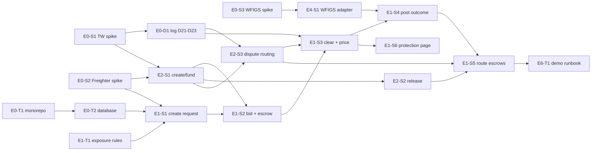

# Parasol by Avantus — Work breakdown

**Version:** 0.1 draft (21 Nov 2026) · **Builds on:** `SPEC.md` v5.1, `docs/DECISIONS.md` D1–D20 and D24, the existing `packages/core` (20 passing tests). Do not re-ticket what exists: `clear`, `protectionPrice`, `maxPriceDeposit`, `validateBid`, `distributePrice`, `settleShare`, `evaluateWildfire`, `evaluateRainRollingMax`, `evaluateQuake`, geo helpers, `validateRequestTerms`, `EscrowPort` and `InMemoryEscrow`.
**Hackathon deadline:** Sun 22 Nov 2026, 23:59 (UTC−6). M1 is the hackathon target; M2 if time allows; M3–M4 become the roadmap.
**Vocabulary:** protection, price, backer, buyer, trigger, payout. Test network and test USDC only (D18). Parasol never holds funds or user keys.

---

## Definition of Ready (every ticket)

- The user story or task states one outcome; acceptance criteria are Given / When / Then.
- SPEC section, FR or D# it implements is linked; any unknown it depends on has a finished spike.
- Dependencies are done or explicitly stubbed.
- Fits in one day for one engineer or one agent session.

## Definition of Done (every ticket)

- Acceptance criteria pass; SPEC acceptance tests named in the ticket pass.
- `npm test` and `npm run typecheck` pass from the repo root.
- No secrets, keys or `.env` files committed; server keys read from environment variables only.
- No floating point in money, rates or measured values (SPEC §1 invariant 2).
- If a decision was made, it is logged in `docs/DECISIONS.md` (Decision · Why · Alternatives rejected · Trade-off · Revisit when) after founder approval.
- Docs touched by the change are updated (SPEC §11 markers, README status).

## Decisions this backlog needs (proposals, not yet in DECISIONS.md)

| # | Proposal | Needed by | Decided in |
|---|---|---|---|
| P-D21 | Buyer deposit sits in its own Trustless Work escrow, split at clearing | E1-S3 | E0-D1 after E0-S1 |
| P-D22 | Separate arbiter key holds the `disputeResolvers` role (Trustless Work V2 forbids overlap) | E2-S3 | E0-D1 after E0-S1 |
| P-D23 | Who bears the Trustless Work 0.30 % fee on releases | E5-S1, SPEC test 13 | E0-D1 after E0-S1 |
| P-D25 | Monorepo with npm workspaces: `packages/core`, `packages/escrow-tw`, `packages/resolver`, `apps/web` (Next.js App Router; route handlers are the API) | E0-T1 | Founders, before E0-T1 |
| P-D26 | Persistence: Postgres via Drizzle ORM (hosted on Vercel Marketplace / Neon; PGlite in tests) | E0-T3 | Founders, before E0-T3 |
| P-D27 | `EscrowPort` becomes two-phase (`prepare*` returns unsigned XDR, `confirm` records the submitted tx), because users sign in their own wallet (D8) | E2-S1 | Founders, before E2-S1 |

---

## Epics

### [E0] Foundations and spikes

### [E0] E0-S1: Answer the Trustless Work escrow unknowns on testnet
`Type: spike   ·   Priority: P0   ·   Estimate: S (time-box 4 h)`
`Labels: area/escrow, milestone/M1`
`Depends on: none`
**User story:** As a resolver, I want to know exactly what Trustless Work allows so that our escrow mapping works the first time.
**Context:** SPEC §2 escrow mapping, D8, D9, D19, P-D21–P-D23. Docs (V2) say the dispute resolver cannot share an address with any other role, resolutions pay a `distributions` list, and releases carry a 0.30 % fee; some points are unanswered.
**Acceptance criteria (Given / When / Then):**
- Given a testnet single-release escrow with five distinct keys (admin, resolver as serviceProvider+approver+releaseSigner, arbiter as disputeResolver, platform, receiver), When it is deployed, funded and released, Then the receiver's balance change and the fees are recorded.
- Given a second funded escrow, When the resolver opens a dispute and the arbiter resolves with 3 `distributions` (one to an address that holds no role), Then we record whether it succeeds and whether the sum is gross or net of fees.
- Given a role set to a `C…` contract address, When initialize is called, Then we record accept or reject.
- Given a resolution that pays less than the balance, When submitted, Then we record whether a remainder can stay in the escrow.
**Out of scope:** writing the production adapter.
**Test plan:** manual script against testnet; results table in `docs/spikes/trustless-work.md`.
**Agent notes:** needs funded testnet accounts and a Trustless Work API key (human). Script in `scripts/spikes/tw.ts`; never commit keys. Answer format: one row per question → yes / no / value, with tx hashes.

### [E0] E0-S2: Prove wallet signing with Freighter on testnet
`Type: spike   ·   Priority: P0   ·   Estimate: S (time-box 4 h)`
`Labels: area/web, milestone/M1`
`Depends on: none`
**User story:** As a buyer, I want to connect my wallet and sign once so that I never hand my keys to Parasol.
**Context:** D8, D16, SPEC §13. Trustless Work returns unsigned XDR to be signed "exactly as returned".
**Acceptance criteria (Given / When / Then):**
- Given Freighter on testnet, When a page calls connect, Then it reads the public key and network.
- Given an unsigned XDR from Trustless Work (from E0-S1), When Freighter signs it and the app submits it, Then the tx hash is confirmed on testnet.
- Given a wallet without a USDC trustline, When connecting, Then we know the exact steps and which faucet provides test USDC.
**Out of scope:** styling; embedded wallets.
**Test plan:** manual; findings in `docs/spikes/freighter.md`.
**Agent notes:** throwaway page under `apps/web/app/spike/`; delete after E1. Human installs Freighter.

### [E0] E0-S3: Confirm the WFIGS data we need for the Palisades scenario
`Type: spike   ·   Priority: P0   ·   Estimate: S (time-box 3 h)`
`Labels: area/data, milestone/M1`
`Depends on: none`
**User story:** As a resolver, I want a real, reproducible fire perimeter so that the wildfire outcome is evidence, not a mock.
**Context:** SPEC §4 `wildfire.perimeter`, §10, §12; `FirePerimeter` needs id, discovered time, acres, ignition point and geometry.
**Acceptance criteria (Given / When / Then):**
- Given the WFIGS perimeter service, When queried for the January 2025 Palisades Fire, Then we have the feature id, discovery time, acres and geometry, and know whether an ignition point is published (and where, if not).
- Given the query URL, When run twice, Then the payload hash is identical, or we know what changes.
**Out of scope:** writing the adapter.
**Test plan:** manual; findings and query URLs in `docs/spikes/wfigs.md`.
**Agent notes:** public data, no key needed. Record licence (public domain) and payload size.

### [E0] E0-D1: Log the escrow decisions from the spike
`Type: task   ·   Priority: P0   ·   Estimate: S`
`Labels: area/compliance, milestone/M1`
`Depends on: E0-S1`
**User story:** As a backer, I want the escrow rules fixed in writing so that I know where my capital can go.
**Context:** P-D21, P-D22, P-D23; SPEC §2, §5, §7.
**Acceptance criteria (Given / When / Then):**
- Given the E0-S1 results, When founders approve, Then P-D21–P-D23 are appended as D21–D23 to `docs/DECISIONS.md` and SPEC §2, §5, §7 and test 13 are updated to match.
**Out of scope:** code.
**Test plan:** review only.
**Agent notes:** human decision; an agent may draft the text but must not merge without founder approval.

### [E0] E0-T1: Set up the monorepo and the web app shell
`Type: task   ·   Priority: P0   ·   Estimate: M`
`Labels: area/infra, milestone/M1`
`Depends on: P-D25 approved`
**User story:** As a buyer, I want a web app to open so that I can start a protection.
**Context:** SPEC §2 architecture, D14, D16, P-D25.
**Acceptance criteria (Given / When / Then):**
- Given a fresh clone, When `npm install && npm test && npm run typecheck` run at the root, Then the existing 20 core tests pass and every workspace type-checks.
- Given `npm run dev -w apps/web`, When opened, Then a page shows the banner "TEST NETWORK — TEST USDC ONLY".
- Given `apps/web`, When it imports `@parasol/core`, Then types resolve without a build step.
**Out of scope:** any feature UI.
**Test plan:** root scripts in CI later (E9-T1).
**Agent notes:** add `workspaces` to root `package.json`; give `packages/core` a `package.json` named `@parasol/core`; create empty `packages/escrow-tw` and `packages/resolver`. Do not change any file under `packages/core/src` or `packages/core/test`.

### [E0] E0-T2: Add the request book schema and database access
`Type: task   ·   Priority: P0   ·   Estimate: M`
`Labels: area/api, milestone/M1`
`Depends on: E0-T1, P-D26 approved`
**User story:** As a buyer, I want my request and its bids stored so that the auction survives a page reload.
**Context:** SPEC §3 domain model (`ProtectionRequest` incl. `exposure`, `Bid`, `Protection`, `Outcome`), P-D26.
**Acceptance criteria (Given / When / Then):**
- Given the schema, When migrations run, Then tables exist for requests, bids, protections, shares, escrows (with Trustless Work contract id and status) and outcomes.
- Given money and measured values, When stored, Then they are integer columns (`numeric` or `bigint`), never float.
- Given PGlite in tests, When the repository functions run, Then create/read/update round-trips pass.
**Out of scope:** API routes.
**Test plan:** unit tests for the repository in `apps/web/lib/db/*.test.ts`.
**Agent notes:** files `apps/web/lib/db/schema.ts`, `apps/web/lib/db/repo.ts`, `drizzle.config.ts`. `DATABASE_URL` from env only.

---

### [E1] Walking skeleton: one wildfire protection end to end

### [E1] E1-T1: Enforce buyer exposure rules in the core
`Type: task   ·   Priority: P0   ·   Estimate: S`
`Labels: area/core, milestone/M1`
`Depends on: none`
**User story:** As a backer, I want every request capped at the buyer's declared exposure so that I never back a bet on someone else's home.
**Context:** D24; SPEC §5, §14; SPEC tests 18–19.
**Acceptance criteria (Given / When / Then):**
- Given a request with `limit > declaredValue`, When validated, Then it throws.
- Given a wallet with an active request on the same template within 100 m, When a new request would push the combined limit above `declaredValue`, Then it throws; Given the same request from another wallet, Then it passes.
**Out of scope:** L1 attestation.
**Test plan:** unit; SPEC tests 18 and 19 implemented and their *(not yet implemented)* markers removed.
**Agent notes:** add `validateExposure(req, activeSameWallet)` in `packages/core/src/templates.ts` or a new `exposure.ts`, export from `index.ts`; use `haversineM`. Do not change existing function signatures.

### [E1] E1-S1: Create a wildfire request
`Type: story   ·   Priority: P0   ·   Estimate: M`
`Labels: area/web, milestone/M1`
`Depends on: E0-T2, E1-T1, E0-S2`
**User story:** As a buyer, I want to create a wildfire protection request for my home so that backers can bid on it.
**Context:** SPEC §5, §9 screen 2; D7, D24; PRD journey 5.1 steps 2–6.
**Acceptance criteria (Given / When / Then):**
- Given a connected wallet, When the buyer submits template `wildfire.perimeter`, a lat/lon, limit, max rate, term, auction end, exposure kind and declared value, Then `POST /api/requests` validates with `validateRequestTerms` and the exposure check and stores the request as `open`.
- Given a term that starts less than 14 days after the auction ends, When submitted, Then the API returns 400 with the rule in plain words.
- Given the form, When shown, Then the template question and basis-risk note appear before the sign button.
**Out of scope:** the buyer deposit escrow (E1-S3), map picker (E7-S1; a lat/lon input is fine).
**Test plan:** integration test for the route; SPEC test 5.
**Agent notes:** `apps/web/app/request/new/page.tsx`, `apps/web/app/api/requests/route.ts`. Values in USDC base units as `bigint` strings over JSON.

### [E1] E1-S2: Place a bid that funds its own escrow
`Type: story   ·   Priority: P0   ·   Estimate: M`
`Labels: area/escrow, milestone/M1`
`Depends on: E1-S1, E2-S1`
**User story:** As a backer, I want my bid to lock its full capacity in my own escrow so that the buyer never depends on my promise.
**Context:** SPEC §5, §9 screen 3; D5, D19; PRD journey 5.2 step 4.
**Acceptance criteria (Given / When / Then):**
- Given an open request, When the backer enters capacity and rate, Then `validateBid` runs and `POST /api/requests/:id/bids` returns unsigned XDR to create and fund one escrow for the full capacity.
- Given the backer signs in Freighter, When the tx is confirmed, Then the bid is stored as funded with its escrow contract id and appears in the bid book.
- Given a rate above `maxRateBps` or a time after `auctionEnd`, When submitted, Then 400 and no XDR is returned.
**Out of scope:** withdrawal (E3-S1).
**Test plan:** integration with `InMemoryEscrow`; one manual testnet run; SPEC test 5.
**Agent notes:** `apps/web/app/requests/[id]/page.tsx`, `apps/web/app/api/requests/[id]/bids/route.ts`; use the `EscrowPort` from E2-S1, never call Trustless Work directly from the route.

### [E1] E1-S3: Clear the auction and pay the price
`Type: story   ·   Priority: P0   ·   Estimate: M`
`Labels: area/api, milestone/M1`
`Depends on: E1-S2, E0-D1, E2-S3`
**User story:** As a buyer, I want the auction to clear at one public price so that my protection starts fully funded.
**Context:** SPEC §6, §7 "At clearing"; D4, D10, D12, D19, P-D21; PRD journey 5.1 step 8.
**Acceptance criteria (Given / When / Then):**
- Given `now ≥ auctionEnd`, When anyone calls `POST /api/requests/:id/clear`, Then `clear()` runs and its inputs and result are published at `GET /api/requests/:id/clearing` with a SHA-256 of the canonical JSON.
- Given a cleared result, When settlement runs, Then the buyer deposit is split as P-D21 says (fee, price shares, excess) and unused capacity returns to its backer.
- Given `filledLimit < minFill`, When cleared, Then the request is `unfilled` and every escrow and the deposit are refunded.
**Out of scope:** the price map.
**Test plan:** integration with `InMemoryEscrow`; SPEC tests 1–4, 13.
**Agent notes:** canonical JSON = sorted keys, bigint as decimal strings. Clearing must be idempotent: a second call returns the stored result.

### [E1] E1-S4: Post a wildfire outcome with evidence
`Type: story   ·   Priority: P0   ·   Estimate: M`
`Labels: area/resolver, milestone/M1`
`Depends on: E4-S1, E1-S3`
**User story:** As a resolver, I want to post an outcome computed from the official perimeter so that anyone can check why it paid.
**Context:** SPEC §1 invariants 4–5, §3 `Outcome`, §7; D11, D13; PRD journey 5.3 steps 2–4.
**Acceptance criteria (Given / When / Then):**
- Given an active wildfire protection and the Palisades fixture, When `POST /api/ops/outcomes` runs, Then `evaluateWildfire` produces an `Outcome` with feature id, data version, retrieval time and SHA-256, stored and shown on the protection page.
- Given no data for the term, When run, Then no outcome is posted and nothing moves.
**Out of scope:** dispute submission (E4-S4).
**Test plan:** integration; SPEC tests 6, 7, 14.
**Agent notes:** route protected by a server-side resolver token from env. Dispute window configurable (`DISPUTE_WINDOW_SECONDS`, minutes on testnet).

### [E1] E1-S5: Route escrows after the dispute window
`Type: story   ·   Priority: P0   ·   Estimate: M`
`Labels: area/escrow, milestone/M1`
`Depends on: E1-S4, E2-S2, E2-S3`
**User story:** As a buyer, I want my payout to arrive once the dispute window closes so that I am paid without filing anything.
**Context:** SPEC §7; D11, P-D22; PRD journey 5.3 step 6.
**Acceptance criteria (Given / When / Then):**
- Given a triggered outcome and an expired window, When settlement runs, Then each accepted escrow is routed to the buyer (via dispute + arbiter resolution, P-D22) and the protection is `triggered`.
- Given not triggered and `now ≥ termEnd`, When settlement runs, Then each escrow is released to its backer.
- Given the window still open, When settlement runs, Then nothing moves.
**Out of scope:** reconciliation (E5-S1).
**Test plan:** integration; SPEC tests 12–14.
**Agent notes:** call `settleShare` per escrow and act only on `state: 'final'`. Arbiter signing happens in the arbiter's wallet on `/ops/arbiter`, never server-side.

### [E1] E1-S6: Show the protection with its escrows and evidence
`Type: story   ·   Priority: P1   ·   Estimate: S`
`Labels: area/web, milestone/M1`
`Depends on: E1-S3`
**User story:** As a buyer, I want one page that shows my protection's status, money and evidence so that I trust it without asking anyone.
**Context:** SPEC §9 screen 4; VISION §7; PRD G5.
**Acceptance criteria (Given / When / Then):**
- Given a protection, When `/protections/:id` opens, Then it shows status, filled limit, clearing rate, shares, each escrow with an explorer link, the outcome with source and hash, and payouts.
**Out of scope:** styling beyond readable defaults.
**Test plan:** component test; manual check.
**Agent notes:** `apps/web/app/protections/[id]/page.tsx`. Reuse the trust panel from E7-S2 later.

---

### [E2] Trustless Work escrow adapter

### [E2] E2-S1: Create and fund an escrow through Trustless Work
`Type: story   ·   Priority: P0   ·   Estimate: M`
`Labels: area/escrow, milestone/M1`
`Depends on: E0-S1, E0-S2, P-D27 approved`
**User story:** As a backer, I want my escrow created and funded from my own wallet so that Parasol never touches my USDC.
**Context:** SPEC §2 escrow mapping, §13; D8, D19; P-D27.
**Acceptance criteria (Given / When / Then):**
- Given a `ShareEscrowSpec`, When `prepareCreate` and `prepareFund` run, Then they return unsigned XDR from Trustless Work V2 with the roles confirmed in E0-S1.
- Given a submitted tx hash, When `confirm` runs, Then the escrow state matches the chain.
- Given the same calls on `InMemoryEscrow`, Then the existing tests still pass.
**Out of scope:** release and disputes.
**Test plan:** unit with a mocked HTTP client; integration against testnet behind `TW_INTEGRATION=1`.
**Agent notes:** new `packages/escrow-tw/src/index.ts` implementing the updated `EscrowPort`; API key from env. Update `InMemoryEscrow` to the two-phase interface without changing test expectations.

### [E2] E2-S2: Release an escrow to its backer
`Type: story   ·   Priority: P0   ·   Estimate: S`
`Labels: area/escrow, milestone/M1`
`Depends on: E2-S1`
**User story:** As a backer, I want my collateral back when nothing triggered or my bid lost so that my capital is free again.
**Context:** SPEC §2, §5 (withdraw), §6 (not accepted), §7 (expiry).
**Acceptance criteria (Given / When / Then):**
- Given a funded escrow, When `releaseToBacker` runs, Then the resolver marks, approves and releases the milestone and the backer's balance increases by the amount minus the Trustless Work fee (per P-D23).
- Given an escrow not in `funded`, When called, Then it throws.
**Out of scope:** payouts to the buyer.
**Test plan:** unit with mock; testnet integration behind flag.
**Agent notes:** resolver key signs server-side (it is a Parasol role, not a user key).

### [E2] E2-S3: Route an escrow by dispute resolution
`Type: story   ·   Priority: P0   ·   Estimate: M`
`Labels: area/escrow, milestone/M1`
`Depends on: E2-S1, E0-D1`
**User story:** As a buyer, I want a triggered escrow routed to me with the evidence attached so that the payout is verifiable.
**Context:** SPEC §2; D11, D19, P-D21, P-D22.
**Acceptance criteria (Given / When / Then):**
- Given a funded escrow and an outcome, When `payBuyer` runs, Then the resolver opens a dispute with the evidence hash and the arbiter's unsigned resolution XDR pays `[{ buyer, amount }]`.
- Given a partial fill, When `splitRefund` runs, Then the resolution pays the unused part to the backer as E0-S1 allows.
- Given the buyer deposit escrow at clearing, When `splitDeposit` runs, Then it pays fee, price shares and excess in one resolution.
**Out of scope:** the arbiter UI (E1-S5).
**Test plan:** unit with mock; testnet integration behind flag.
**Agent notes:** never route to an address other than the escrow's buyer, backer, platform or (deposit) the accepted backers; assert this in code before preparing XDR.

---

### [E3] Request and auction lifecycle

### [E3] E3-S1: Withdraw a bid before the auction ends
`Type: story   ·   Priority: P1   ·   Estimate: S`
`Labels: area/web, milestone/M2`
`Depends on: E1-S2, E2-S2`
**User story:** As a backer, I want to withdraw my bid before the auction closes so that I am not locked in by mistake.
**Context:** SPEC §5.
**Acceptance criteria (Given / When / Then):**
- Given `now < auctionEnd`, When the backer withdraws, Then the escrow is released to them and the bid leaves the book.
- Given `now ≥ auctionEnd`, When withdraw is called, Then 400.
**Out of scope:** partial withdrawal.
**Test plan:** integration.
**Agent notes:** `DELETE /api/requests/:id/bids/:bidId`.

### [E3] E3-S2: Cancel a request before the first bid
`Type: story   ·   Priority: P2   ·   Estimate: S`
`Labels: area/web, milestone/M2`
`Depends on: E1-S3`
**User story:** As a buyer, I want to cancel a request nobody has bid on so that my deposit comes back.
**Context:** SPEC §5; P-D21.
**Acceptance criteria (Given / When / Then):**
- Given zero bids, When the buyer cancels, Then the request is `cancelled` and the deposit escrow is released to the buyer.
- Given at least one bid, When cancel is called, Then 400.
**Out of scope:** none.
**Test plan:** integration.
**Agent notes:** `POST /api/requests/:id/cancel`, buyer signature required.

### [E3] E3-T1: Make clearing reject invalid bids
`Type: task   ·   Priority: P1   ·   Estimate: S`
`Labels: area/core, milestone/M2`
`Depends on: founder approval of fix C1`
**User story:** As a buyer, I want clearing to refuse a bid above my maximum rate so that my price never exceeds my deposit.
**Context:** SPEC §5–6; proposed fix C1.
**Acceptance criteria (Given / When / Then):**
- Given a bid above `maxRateBps` or after `auctionEnd` in the book, When `clear` runs, Then it throws.
- Given any valid book, When cleared, Then `price ≤ maxPriceDeposit(req)`.
**Out of scope:** none.
**Test plan:** unit; new SPEC test (number assigned when approved).
**Agent notes:** add `auctionEnd` to `AuctionRequest`; update callers and tests in `packages/core`.

---

### [E4] Resolver and data adapters

### [E4] E4-S1: Build the WFIGS adapter and the Palisades fixture
`Type: story   ·   Priority: P0   ·   Estimate: M`
`Labels: area/data, milestone/M1`
`Depends on: E0-S3`
**User story:** As a resolver, I want the Palisades perimeter stored with its provenance so that the wildfire outcome is reproducible.
**Context:** SPEC §4, §10, §12; D13; proposed fix C2.
**Acceptance criteria (Given / When / Then):**
- Given the WFIGS query from E0-S3, When `scripts/fetch-fixtures.ts wildfire` runs, Then `data/wfigs/palisades-2025.json` holds the features, source URL, retrieval time and SHA-256.
- Given the adapter, When it returns fires for a term, Then it also returns the coverage interval it queried, so an empty list with incomplete coverage yields insufficient data.
- Given 6–8 synthetic points around the perimeter, When evaluated, Then inside and edge points trigger and the 2 km point does not.
**Out of scope:** live polling.
**Test plan:** unit; SPEC tests 6–7.
**Agent notes:** `packages/resolver/src/wildfire.ts`; reuse `evaluateWildfire`. Synthetic points only, no real addresses (SPEC §12).

### [E4] E4-S2: Build the ERA5 adapter and the rainfall fixtures
`Type: story   ·   Priority: P1   ·   Estimate: M`
`Labels: area/data, milestone/M2`
`Depends on: E0-T1`
**User story:** As a resolver, I want the Tarrazú and Liberia rainfall stored with provenance so that the rainfall outcomes are reproducible.
**Context:** SPEC §4 rainfall rules, §10, §11 tests 8–9; D13.
**Acceptance criteria (Given / When / Then):**
- Given Open-Meteo with `models=era5`, `timezone=GMT`, When the fetch script runs, Then fixtures store hourly tenths of mm (integers, nulls kept), URL, retrieval time and SHA-256.
- Given the Liberia fixture, When evaluated (72 h, 2,000 tenths, Oct 2017), Then observed 2,139 with window ending 2017-10-06T18:00Z.
- Given the Tarrazú fixture, When evaluated (72 h, 4,000 tenths, 2024-07-01 to 2025-06-30), Then observed 4,624.
**Out of scope:** other locations.
**Test plan:** unit; SPEC tests 8, 9, 11.
**Agent notes:** `packages/resolver/src/rain.ts`, `data/era5/*.json`. Credit Open-Meteo and Copernicus in README.

### [E4] E4-S3: Build the USGS adapter and the Nicoya fixture
`Type: story   ·   Priority: P1   ·   Estimate: S`
`Labels: area/data, milestone/M2`
`Depends on: E0-T1`
**User story:** As a resolver, I want the 2012 Nicoya earthquake from the official catalog so that the earthquake outcome is evidence.
**Context:** SPEC §4, §10, §11 test 10; proposed fix C3 (magnitude as integer tenths).
**Acceptance criteria (Given / When / Then):**
- Given the USGS catalog query for 2012 within 50 km of (10.15, −85.45), When fetched, Then the fixture stores the event id, time, magnitude and epicentre with provenance.
- Given the fixture, When evaluated (≥ 7.0, 50 km, term 2012), Then triggered with the catalog event id as evidence.
**Out of scope:** ShakeMap.
**Test plan:** unit; SPEC test 10 switched from synthetic to fixture.
**Agent notes:** `packages/resolver/src/quake.ts`, `data/usgs/nicoya-2012.json`.

### [E4] E4-S4: Let anyone dispute an outcome
`Type: story   ·   Priority: P1   ·   Estimate: M`
`Labels: area/resolver, milestone/M2`
`Depends on: E1-S4`
**User story:** As a backer, I want to challenge a wrong outcome with evidence so that a bad data read does not cost me my capital.
**Context:** SPEC §7 dispute window; D7, D11, P-D22.
**Acceptance criteria (Given / When / Then):**
- Given an open window, When someone submits counter-evidence (text plus URL or file hash), Then it is stored, shown on the protection page and settlement waits for the arbiter.
- Given a closed window, When submitted, Then 400.
**Out of scope:** bonded disputes (roadmap).
**Test plan:** integration.
**Agent notes:** `POST /api/protections/:id/disputes`; files are not stored, only hashes and URLs.

### [E4] E4-T1: Prove resolver determinism
`Type: task   ·   Priority: P2   ·   Estimate: S`
`Labels: area/resolver, milestone/M2`
`Depends on: E4-S1, E4-S2, E4-S3`
**User story:** As a backer, I want two resolver runs on the same data to agree so that the outcome is a fact, not a judgement.
**Context:** SPEC §1 invariant 6; SPEC test 16.
**Acceptance criteria (Given / When / Then):**
- Given each fixture, When the resolver runs twice, Then `dataSha256` and the outcome are identical.
**Out of scope:** none.
**Test plan:** unit; SPEC test 16.
**Agent notes:** `packages/resolver/test/determinism.test.ts`.

---

### [E5] Settlement integrity

### [E5] E5-S1: Reconcile chain movements with the core
`Type: story   ·   Priority: P1   ·   Estimate: M`
`Labels: area/escrow, milestone/M2`
`Depends on: E1-S5, E0-D1`
**User story:** As a backer, I want every on-chain movement checked against the rules so that a mismatch is caught the same day.
**Context:** PRD §3 guardrails; SPEC §7; P-D23.
**Acceptance criteria (Given / When / Then):**
- Given settled protections, When `npm run reconcile` runs, Then for each escrow the on-chain amounts equal `distributePrice` / `settleShare` (net of the P-D23 fee) and any mismatch, payout without evidence or move on missing data is reported with a non-zero exit.
**Out of scope:** alerting integrations.
**Test plan:** unit with fixtures of chain data.
**Agent notes:** `scripts/reconcile.ts`; read-only.

### [E5] E5-T1: Fuzz escrow balances against what is owed
`Type: task   ·   Priority: P2   ·   Estimate: S`
`Labels: area/core, milestone/M2`
`Depends on: none`
**User story:** As a backer, I want random auctions and outcomes to never leave money unaccounted for so that the rules hold in every case.
**Context:** SPEC test 15.
**Acceptance criteria (Given / When / Then):**
- Given 1,000 random books and outcomes, When cleared and settled with `InMemoryEscrow`, Then escrow balances always equal what remains owed and all transfers sum to deposits.
**Out of scope:** none.
**Test plan:** property test; SPEC test 15.
**Agent notes:** seeded PRNG for reproducibility; no new dependency unless approved.

### [E5] E5-S2: Publish a recompute script for clearing
`Type: story   ·   Priority: P2   ·   Estimate: S`
`Labels: area/core, milestone/M2`
`Depends on: E1-S3`
**User story:** As a backer, I want to recompute any clearing myself so that I do not have to trust Parasol's server.
**Context:** D10; PRD G3.
**Acceptance criteria (Given / When / Then):**
- Given a request id, When `npx @parasol/core recompute <url>` runs, Then it downloads the published inputs, runs `clear()` and prints match or mismatch with the published hash.
**Out of scope:** a web UI.
**Test plan:** unit.
**Agent notes:** `packages/core/bin/recompute.ts`.

---

### [E6] Reference scenarios

### [E6] E6-S1: Seed the three reference scenarios on testnet
`Type: story   ·   Priority: P1   ·   Estimate: M`
`Labels: area/infra, milestone/M2`
`Depends on: E1-S5, E4-S1, E4-S2, E4-S3`
**User story:** As a backer, I want realistic demo markets with several bidders so that I can see clearing, partial fills and unfilled requests.
**Context:** SPEC §10.
**Acceptance criteria (Given / When / Then):**
- Given `npm run seed:testnet`, When it finishes, Then Palisades points, the Tarrazú farm and the Nicoya shop exist as requests with 4–5 test backer wallets bidding; one clears partially and one goes unfilled.
**Out of scope:** real addresses.
**Test plan:** manual run plus a smoke test that reads the API.
**Agent notes:** test wallet secrets in a local `.env.seed`, never committed.

### [E6] E6-S2: Run the rainfall protection end to end
`Type: story   ·   Priority: P1   ·   Estimate: S`
`Labels: area/resolver, milestone/M2`
`Depends on: E6-S1`
**User story:** As a buyer with a coffee farm, I want my storm protection to pay from the November 2024 rainfall so that a different risk works on the same market.
**Context:** SPEC §10; D20.
**Acceptance criteria (Given / When / Then):**
- Given the Tarrazú protection, When the resolver runs and the window closes, Then the buyer receives the filled limit and the outcome shows 462.4 mm with its window.
**Out of scope:** none.
**Test plan:** e2e on testnet; SPEC test 9.
**Agent notes:** reuse E1 flows; only the template differs.

### [E6] E6-S3: Run the earthquake protection end to end
`Type: story   ·   Priority: P1   ·   Estimate: S`
`Labels: area/resolver, milestone/M2`
`Depends on: E6-S1`
**User story:** As a shop owner, I want my earthquake protection to pay from the 2012 Nicoya event so that the third risk works too.
**Context:** SPEC §10; D20.
**Acceptance criteria (Given / When / Then):**
- Given the Nicoya protection, When the resolver runs and the window closes, Then the buyer receives the filled limit and the outcome shows the USGS event id and magnitude.
**Out of scope:** none.
**Test plan:** e2e on testnet; SPEC test 10.
**Agent notes:** reuse E1 flows.

### [E6] E6-T1: Write and rehearse the demo runbook
`Type: task   ·   Priority: P0   ·   Estimate: S`
`Labels: area/infra, milestone/M1`
`Depends on: E1-S5`
**User story:** As a resolver, I want a step-by-step demo script so that the walkthrough works live in 90 seconds.
**Context:** SPEC §10 walkthrough.
**Acceptance criteria (Given / When / Then):**
- Given `docs/DEMO.md`, When followed from a clean seed, Then the wildfire walkthrough completes, with a fallback recording if testnet is slow.
**Out of scope:** slides.
**Test plan:** two timed rehearsals.
**Agent notes:** human-led; agent can draft.

---

### [E7] Trust UX and map

### [E7] E7-S1: Show requests and clearing rates on a map
`Type: story   ·   Priority: P2   ·   Estimate: M`
`Labels: area/web, milestone/M3`
`Depends on: E1-S3`
**User story:** As a backer, I want to see open requests and cleared prices on a map so that I find risks I understand.
**Context:** SPEC §9 screen 1; D16 (MapLibre).
**Acceptance criteria (Given / When / Then):**
- Given open and cleared items, When `/` loads, Then markers show time left and best rate (open) or clearing rate (cleared), filterable by template; the request form uses the map to pick a location.
**Out of scope:** heatmaps.
**Test plan:** component test; manual.
**Agent notes:** `apps/web/components/Map.tsx`; free tile source with attribution.

### [E7] E7-S2: Add the trust panel to every screen
`Type: story   ·   Priority: P1   ·   Estimate: S`
`Labels: area/web, milestone/M3`
`Depends on: E1-S6`
**User story:** As a buyer, I want every screen to show source, evidence, escrow status, basis risk and exposure status so that I never sign blind.
**Context:** PRD G5; VISION §7; D24.
**Acceptance criteria (Given / When / Then):**
- Given any request or protection screen, When rendered, Then the panel shows data source and version, evidence hash (when present), escrow states with explorer links, basis-risk note and the exposure badge.
**Out of scope:** none.
**Test plan:** component test.
**Agent notes:** `apps/web/components/TrustPanel.tsx`.

### [E7] E7-S3: List the three templates
`Type: story   ·   Priority: P3   ·   Estimate: S`
`Labels: area/web, milestone/M3`
`Depends on: E0-T1`
**User story:** As a backer, I want to read each template's question, source and basis risk so that I know what I am backing.
**Context:** SPEC §9 screen 5; D20.
**Acceptance criteria (Given / When / Then):**
- Given `/templates`, When opened, Then the three templates show question, source, licence, basis-risk note and how many protections use each.
**Out of scope:** publishing templates.
**Test plan:** component test.
**Agent notes:** static data from `packages/core`.

### [E7] E7-T1: Pass a WCAG 2.2 AA check on the core flows
`Type: task   ·   Priority: P2   ·   Estimate: S`
`Labels: area/web, milestone/M3`
`Depends on: E7-S1, E7-S2`
**User story:** As a buyer using a keyboard or screen reader, I want to complete a request and a bid so that Parasol works for me.
**Context:** PRD §7 (to write).
**Acceptance criteria (Given / When / Then):**
- Given request, bid and protection screens, When audited, Then no AA violations in axe and every action is keyboard reachable; status never relies on colour alone.
**Out of scope:** none.
**Test plan:** axe in component tests; manual keyboard pass.
**Agent notes:** fix findings in place.

---

### [E8] Risk brief (AI)

### [E8] E8-S1: Build the facts JSON for each template
`Type: story   ·   Priority: P2   ·   Estimate: S`
`Labels: area/ai, milestone/M3`
`Depends on: E4-S1, E4-S2, E4-S3`
**User story:** As a backer, I want the public facts about a location in one place so that I can price an unfamiliar risk.
**Context:** SPEC §8; D17.
**Acceptance criteria (Given / When / Then):**
- Given a request, When `buildFacts` runs, Then wildfire returns distance to the nearest historical perimeter and fires within 5 km since 2000; rainfall returns years over threshold in the last 35 and the largest value; all templates return nearby clearing rates.
**Out of scope:** the LLM.
**Test plan:** unit on fixtures.
**Agent notes:** `packages/resolver/src/facts.ts`.

### [E8] E8-S2: Write the risk brief and validate every number
`Type: story   ·   Priority: P2   ·   Estimate: M`
`Labels: area/ai, milestone/M3`
`Depends on: E8-S1`
**User story:** As a backer, I want a short brief whose numbers are all true so that I can trust it at a glance.
**Context:** SPEC §8; D17; SPEC test 17.
**Acceptance criteria (Given / When / Then):**
- Given facts JSON, When the LLM writes the brief, Then every number in the text must exist in the JSON (comma/period and thousands separators normalised) or the deterministic template text is shown.
- Given no API key or network, When the page loads, Then the template text appears, labelled.
- Given the brief, When shown, Then it is labelled "AI-written, numbers checked" or "Template".
**Out of scope:** AI in clearing or settlement (never).
**Test plan:** unit for the validator; SPEC test 17; eval set from E8-T1.
**Agent notes:** `apps/web/lib/ai/brief.ts`, server only; key from env.

### [E8] E8-T1: Create the risk brief eval set
`Type: task   ·   Priority: P3   ·   Estimate: S`
`Labels: area/ai, milestone/M3`
`Depends on: E8-S2`
**User story:** As a backer, I want the brief tested on many cases so that a bad prompt change is caught.
**Context:** D17.
**Acceptance criteria (Given / When / Then):**
- Given 20 facts JSONs across the three templates, When the eval runs, Then ≥ 95 % pass the validator and 100 % of failures fall back to the template.
**Out of scope:** human rating.
**Test plan:** `npm run eval:brief`.
**Agent notes:** cases in `apps/web/lib/ai/evals/`.

---

### [E9] Access controls and hardening

### [E9] E9-T1: Run typecheck and tests on every pull request
`Type: task   ·   Priority: P1   ·   Estimate: S`
`Labels: area/infra, milestone/M4`
`Depends on: E0-T1`
**User story:** As a backer, I want every change tested before merge so that the rules I rely on cannot silently break.
**Context:** D14.
**Acceptance criteria (Given / When / Then):**
- Given a pull request, When opened, Then GitHub Actions runs `npm ci`, `npm run typecheck` and `npm test` on Node 22 and reports a check.
**Out of scope:** branch protection (repo admin sets it).
**Test plan:** open a PR and see the check.
**Agent notes:** `.github/workflows/ci.yml`.

### [E9] E9-S1: Add jurisdiction and identity thresholds behind flags
`Type: story   ·   Priority: P3   ·   Estimate: M`
`Labels: area/compliance, milestone/M4`
`Depends on: E1-S1`
**User story:** As a buyer, I want markets opened only where Parasol is cleared so that I am not exposed to an unlawful product.
**Context:** SPEC §14; D18.
**Acceptance criteria (Given / When / Then):**
- Given `allowedRegions` and `kycThreshold` config, When a request outside a region or above the threshold without attestation arrives, Then it is rejected; on testnet the flags are off except D24's L0 rules.
**Out of scope:** an identity provider integration.
**Test plan:** unit.
**Agent notes:** config in `apps/web/lib/config.ts`.

### [E9] E9-S2: Require an exposure attestation above the threshold
`Type: story   ·   Priority: P3   ·   Estimate: M`
`Labels: area/compliance, milestone/M4`
`Depends on: E9-S1`
**User story:** As a backer, I want large protections tied to verified exposure so that stacking across wallets is stopped.
**Context:** SPEC §14 L1; D24.
**Acceptance criteria (Given / When / Then):**
- Given a request above `kycThreshold`, When it lacks a valid attestation from an approved verifier, Then it is rejected; Given a payout above the threshold, When the attestation has expired, Then settlement waits.
**Out of scope:** choosing verifiers (legal).
**Test plan:** unit.
**Agent notes:** verify signature over `{ wallet, capValue, expiresAt }`; store only the attestation and its hash.

### [E9] E9-T2: Add structured logs and settlement events
`Type: task   ·   Priority: P3   ·   Estimate: S`
`Labels: area/infra, milestone/M4`
`Depends on: E1-S5`
**User story:** As a resolver, I want every request, bid, clearing, outcome and routing logged so that I can trace any protection.
**Context:** PRD §7 (to write).
**Acceptance criteria (Given / When / Then):**
- Given any state change, When it happens, Then a JSON log line with protection id, step and tx hash is emitted; no personal data.
**Out of scope:** dashboards.
**Test plan:** unit on the logger.
**Agent notes:** `apps/web/lib/log.ts`.

---

## Epic table

| ID | Goal | Stories / tasks | Milestone | Critical path |
|---|---|---|---|---|
| E0 | Foundations and spikes | 6 | M1 | yes |
| E1 | Walking skeleton (wildfire end to end) | 7 | M1 | yes |
| E2 | Trustless Work escrow adapter | 3 | M1 | yes |
| E3 | Request and auction lifecycle | 3 | M2 | no |
| E4 | Resolver and data adapters | 5 | M1 (E4-S1) / M2 | yes (E4-S1) |
| E5 | Settlement integrity | 3 | M2 | no |
| E6 | Reference scenarios | 4 | M1 (E6-T1) / M2 | no |
| E7 | Trust UX and map | 4 | M3 | no |
| E8 | Risk brief (AI) | 3 | M3 | no |
| E9 | Access controls and hardening | 4 | M4 | no |

## Milestones

| Milestone | Scope | Demo criteria |
|---|---|---|
| **M1 Walking skeleton** (hackathon) | E0, E1, E2, E4-S1, E6-T1 | One wildfire protection goes request → bids from 2+ wallets → clearing → testnet escrows funded → Palisades outcome posted → dispute window (minutes) → payout to the buyer, every step with a tx hash or evidence hash. Ugly is fine. |
| **M2 Three templates + reference scenarios** | E3, E4, E5, E6 | The three SPEC §10 scenarios run on testnet from a seed: one partial fill, one unfilled, rainfall and earthquake payouts, reconcile script clean. |
| **M3 Polished UX and risk brief** | E7, E8 | Map, trust panel on every screen, validated risk brief with fallback, WCAG 2.2 AA on core flows. |
| **M4 Access controls and hardening** | E9 | CI on every PR, region and threshold flags, L1 attestation path, structured logs. |

## Dependency graph

**Critical path (M1):** E0-S1 → E2-S1 → E1-S2 → E1-S3 → E1-S4 → E1-S5 → E6-T1. In parallel from the start: E0-S2, E0-S3 → E4-S1, E0-T1 → E0-T2, E1-T1.

## Who can take each ticket

| Safe for an AI coding agent as written | Needs a human |
|---|---|
| E0-T1, E0-T2, E1-T1, E1-S1, E1-S3, E1-S4, E1-S6, E2-S1–S3 (code; testnet runs need keys), E3-*, E4-*, E5-*, E6-S2, E6-S3, E7-*, E8-*, E9-T1, E9-S1, E9-S2, E9-T2 | **Keys and accounts:** E0-S1, E0-S2, E6-S1 (testnet wallets, Trustless Work API key, Freighter). **Decisions:** E0-D1 and P-D21–P-D27 (founders). **Signing:** the arbiter step in E1-S5 (a person's wallet). **Demo and legal copy:** E6-T1, any "not an insurer" or basis-risk wording. **Repo admin:** branch protection after E9-T1. |
